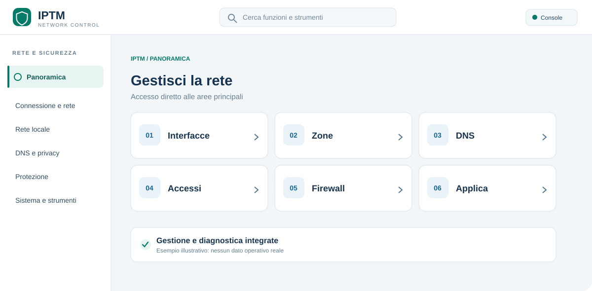

# IPTM — Network Control

**Versione attuale: 5.20.25** · [Sorgenti](./) · [Pacchetti ZIP](release/) · [Novità](CHANGELOG.md)

IPTM è una console web per amministrare **rete, iptables, DNS e servizi di sicurezza** su **DietPi/Debian**. L'interfaccia organizza le funzioni per percorso di rete: **Interfacce → Zone → DNS → Accessi → Firewall → Applica**.



*Immagine schematica della console, non un'acquisizione di uno stato di rete reale.*

## Funzionalità

- **Rete e firewall:** interfacce WAN/LAN, NAT Single-NIC, iptables, IPv4/IPv6, VLAN e zone IoT.
- **DNS e privacy:** configurazione e controlli per Pi-hole, Unbound, DNSCrypt e protezione anti-bypass (quando disponibili).
- **Sicurezza:** diagnostica e strumenti per CrowdSec, Suricata, monitoraggio e regole personalizzate.
- **QoS:** CAKE/SQM, IFB e politiche DSCP, con disattivazione selettiva delle catene IPTM e conservazione delle regole di terzi (5.20.25).
- **Manutenzione:** backup, import/export, diagnostica e aggiornamenti web con manifest SHA-256 e procedure di recupero.

Alcune funzioni dipendono da servizi esterni installati e configurati separatamente. Non tutte vengono abilitate automaticamente.

## Download

| Uso | Pacchetto | 
| --- | --- |
| **Prima installazione** su DietPi/Debian | [IPTM_5_20_25_FRESH_INSTALL_DIETPI.zip](release/IPTM_5_20_25_FRESH_INSTALL_DIETPI.zip) |
| **Aggiornamento** di IPTM esistente | [IPTM_5_20_25_DSCP_SAFE_DISABLE_NATIVE_WEB_UPDATE.zip](release/IPTM_5_20_25_DSCP_SAFE_DISABLE_NATIVE_WEB_UPDATE.zip) |

I due ZIP **non sono intercambiabili**: il pacchetto Fresh Install usa `install.sh` e configura le componenti iniziali; il pacchetto Native Update si importa solo dalla console IPTM già installata.

## Prima installazione su DietPi / Debian

### Requisiti

- DietPi o Debian con **systemd**, **Python 3**, Bash, `sudo`, `visudo`, `iptables` e strumenti iproute2.
- **PHP 8 o superiore** (inclusa CLI) e un **server web già configurato per eseguire PHP** (Apache, Lighttpd o nginx + PHP-FPM).
- Document root esistente, di proprietà di root e non scrivibile da gruppo/altri; utente effettivo del processo PHP noto (valore predefinito `www-data`).
- Permessi di amministratore (`sudo`/root) per eseguire la prima installazione.

> **Attenzione Pi-hole:** il server web integrato di Pi-hole non garantisce l'esecuzione di PHP. L'installer **non installa né configura il web server**, non cambia porte e non riavvia Pi-hole.

### Installazione da ZIP

1. [Scarica il pacchetto per la prima installazione](release/IPTM_5_20_25_FRESH_INSTALL_DIETPI.zip) e copialo sul server.
2. Apri un terminale nel percorso dove si trova lo ZIP, quindi esegui:

   ```bash
   unzip IPTM_5_20_25_FRESH_INSTALL_DIETPI.zip -d iptm-installer
   cd iptm-installer
   sudo bash install.sh --dry-run
   sudo bash install.sh
   ```

3. Apri **`https://IP_DEL_SERVER/iptables-manager.php`** sulla **porta configurata per il server PHP esistente**. Se il server non dispone di TLS, usa un tunnel SSH o limita l'accesso a una rete fidata.
4. Al primo accesso usa l'utente **`admin`**, e il codice temporaneo generato sul server per impostare la password:

   ```bash
   sudo cat /var/lib/iptables-manager/setup-token.txt
   ```

   Il token viene eliminato dopo la configurazione della password.

Se la document root o l'utente PHP sono diversi:

```bash
sudo bash install.sh --web-root /percorso/document-root --web-user nome-utente-php
```

L'installer colloca la console in `iptables-manager.php`, il runtime in `/usr/local/lib/iptables-manager/`, l'helper in `/usr/local/sbin/iptm-helper`, dati sotto `/var/lib/iptables-manager/` e una unità di recupero aggiornamenti. Predispone anche una regola sudo per consentire all'utente PHP di invocare l'helper privilegiato: **proteggi rigorosamente l'accesso alla console**.

Non sovrascrive un'installazione IPTM esistente. Non applica regole iptables, DNS, NAT, QoS o routing in fase di prima installazione. La funzionalità del sistema è stata verificata mediante simulazioni e controlli sintattici, **non collaudata end-to-end su tutte le versioni DietPi**.

## Aggiornamento di un'installazione esistente

1. Salva un backup della configurazione e assicurati di avere accesso di recupero alla macchina.
2. Apri la console IPTM come amministratore e vai in **Sistema e strumenti → Aggiornamenti** (`?p=update`).
3. Carica **solo** [l'archivio Native Update 5.20.25](release/IPTM_5_20_25_DSCP_SAFE_DISABLE_NATIVE_WEB_UPDATE.zip).
4. Esegui l'installazione con la procedura integrata e controlla versione e stato dei servizi.

**Non** estrarre il Native Update direttamente nelle directory di sistema. Gli hash del manifest verificano la coerenza dei file rispetto al pacchetto, ma **non costituiscono una firma crittografica dell'autore**.

## Struttura del repository

| Percorso | Contenuto |
| --- | --- |
| `loader/` | Punto d'accesso della console PHP |
| `modules/`, `actions/` | Interfaccia, configurazioni e azioni |
| `assets/` | CSS e JavaScript |
| `extensions/`, `runtime/` | Componenti Python e helper |
| `installer/` | Sorgenti dell'installer Fresh Install |
| `release/` | Pacchetti ZIP di installazione e aggiornamento |
| `native-manifest.json` | Manifest dei sorgenti versione 5.20.25 |
| `CHANGELOG.md` | Cronologia delle modifiche |

## Sicurezza e licenza

Le operazioni su iptables e DNS possono interrompere la connettività; utilizzare sempre il rollback e una via di accesso indipendente quando si gestiscono sistemi remoti. Evitare di esporre la console amministrativa su Internet.

Licenza del repository: [GNU GPL v3](LICENSE). Le dipendenze di terze parti possono avere licenze distinte.
