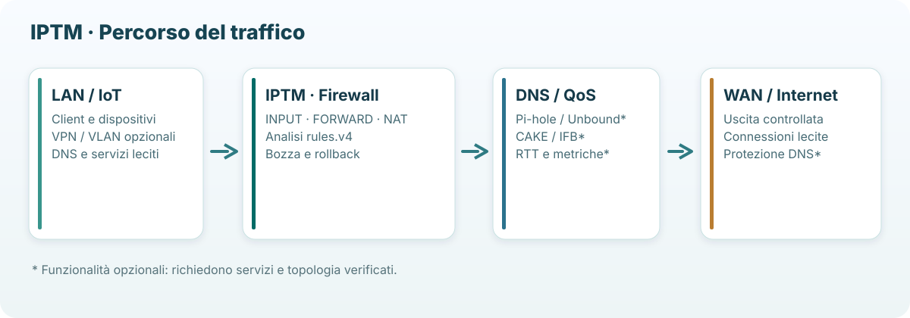
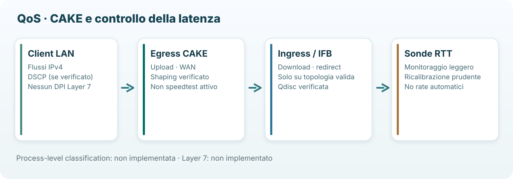

# IPTM — Firewall, Network & QoS Control

**IPTM 5.30.1** · Console web per **DietPi e Debian Linux** · Firewall basato prioritariamente su **iptables** · PHP 8+, Python 3, Bash, JavaScript.

[](https://github.com/Graycius/IPTM/actions/workflows/security-ci.yml)
[](https://github.com/Graycius/IPTM/actions/workflows/codeql.yml)
[](https://github.com/Graycius/IPTM/actions/workflows/semgrep.yml)

**Una sola interfaccia per preparare regole, controllare i servizi di rete e applicare modifiche con protezioni contro il lockout.** IPTM combina un generatore `rules.v4`, analisi di precedenza e anomalie, gestione DNS e dispositivi IoT, diagnostica e strumenti QoS/CAKE. Le funzioni non sono abilitate semplicemente installando il software: si attivano secondo le configurazioni e gli strumenti effettivamente presenti.


*Illustrazione schematica dell'interfaccia, non una schermata acquisita da un sistema in esecuzione.*

## Cosa gestisce

| Area | Cosa permette | Limiti e prerequisiti |
| --- | --- | --- |
| **Firewall IPv4/IPv6** | Generazione di regole, default-drop, servizi INPUT/FORWARD, NAT, liste IP e import/export | Applicazione reale subordinata a backend, interfacce, ipset e controlli di recupero; il codice dà priorità a iptables |
| **Continuità SSH** | Regole `recent`/`connlimit` sui soli SYN `NEW`, protezione delle sessioni `ESTABLISHED`, recupero mirato da console amministrativa | Non corregge disconnessioni causate da driver, QoS, link fisico o regole esterne |
| **Reti e IoT** | Subnet LAN, interfacce, VLAN, isolamento per MAC, DNS forzato e blocchi anti-bypass | La protezione per MAC dipende dalla topologia di livello 2; non sostituisce una VLAN reale |
| **DNS e privacy** | Controlli e integrazioni per Pi-hole, Unbound, DNSCrypt e regole DNS | I relativi demoni non vengono installati e avviati automaticamente |
| **QoS / SQM** | CAKE per upload/download, IFB dove valido, politica DSCP IPv4 e sonde RTT | Velocità e qdisc richiedono verifica sul kernel; la ricalibrazione sotto CAKE non esegue speedtest invasivi |
| **Difesa e diagnostica** | CrowdSec, Suricata, log, audit e monitoraggio, se installati | Nessun servizio di sicurezza esterno è fornito automaticamente |
| **Aggiornamenti e backup** | Pacchetto Native Update, manifest SHA-256, esportazione e ripristino | SHA-256 non è una firma del produttore; un download HTTP richiede hash da una fonte fidata indipendente |



*Diagramma concettuale: la presenza di un blocco non certifica che il servizio sia installato o attivo.*

## Il principio più importante: non perdere la connettività

I firewall sono **sensibili all'ordine**: una regola `ACCEPT` generica può annullare restrizioni successive; un rate-limit applicato prima di `ESTABLISHED` può interrompere SSH; una qdisc mal calibrata può rendere lenta l'intera LAN. La versione **5.30.1** introduce o mantiene queste difese:

- **SSH:** controllo dei tentativi solo su `--ctstate NEW --syn`, senza contare ogni pacchetto di una connessione già stabilita.
- **Bozza prima del kernel:** analisi di `rules.v4` e riorganizzazione in memoria, senza applicare automaticamente le correzioni.
- **Preflight e rollback:** verifiche delle condizioni di navigazione e del meccanismo di recupero prima di applicare modifiche critiche.
- **Accesso amministrativo:** eccezioni solo per reti attendibili configurate; niente apertura indiscriminata di TCP/22 o delle API Docker 2375/2376.
- **Traffico lecito:** evita blocchi generici incompatibili con servizi locali, NAT/forwarding, DNS, discovery e tunnel VPN.
- **QoS non invasivo:** se CAKE è già attivo o la WAN è occupata, rinvia gli speedtest; l'adattamento leggero misura RTT senza riscrivere automaticamente le bande.


> **Attenzione:** queste protezioni non costituiscono una garanzia di connettività. Prima di applicare regole su un host remoto prepara accesso fisico/console di emergenza. Le prove offline non sostituiscono un test su DietPi reale.

## Scaricare e installare

**Ultima versione pubblicata nel repository: 5.30.1.** I due archivi hanno destinazioni diverse:

| Pacchetto | Utilizzo |
| --- | --- |
| [**Fresh Install — DietPi/Debian**](release/IPTM_5_30_1_FRESH_INSTALL_DIETPI.zip) | Prima installazione, quando IPTM non è ancora presente |
| [**Native Web Update — 5.30.1**](release/IPTM_5_30_1_SSH_HTTP_QOS_NATIVE_WEB_UPDATE.zip) | Aggiornamento di una console IPTM esistente |
| [**Sorgente completo**](release/IPTM_5_30_1_COMPLETE_SOURCE.zip) | Consultazione e audit dei file PHP, Python, Bash, JS e test |
| [**Suite di test offline**](release/IPTM_5_30_1_OFFLINE_TESTS.zip) | Ripetizione dei test di regressione in un ambiente di laboratorio |

### Requisiti di prima installazione

- DietPi/Debian con `systemd`, Python 3, PHP **8+**, `sudo`, `visudo` e iptables.
- **Un server web già configurato per eseguire PHP** (ad esempio Apache, nginx con PHP-FPM o Lighttpd con PHP). Il web server integrato di Pi-hole **non è automaticamente idoneo** per PHP.
- Accesso root via console locale o SSH; una strada di recupero se la rete o SSH hanno già problemi.
- I servizi opzionali (Pi-hole, WireGuard, CrowdSec, CAKE, ecc.) richiedono installazione e configurazione proprie.

### 1. Prima installazione

Estrai lo ZIP di **Fresh Install**, poi dalla cartella estratta esegui:

```bash
sudo bash install.sh --dry-run
sudo bash install.sh
```

Se PHP è eseguito con un utente o document root non standard:

```bash
sudo bash install.sh --web-root /percorso/document-root --web-user utente-php
```

Apri `http://IP_DEL_SERVER/iptables-manager.php` sulla **porta del web server con PHP già attivo**. Configura la password dell'amministratore al primo accesso utilizzando il token leggibile soltanto sul server:

```bash
sudo cat /var/lib/iptables-manager/setup-token.txt
```

L'installer installa console, helper privilegiato, codice versione 5.30.1, area dati e componenti di recupero degli aggiornamenti. **Non** modifica automaticamente iptables attivo, DNS, indirizzi di rete, NAT, qdisc o Pi-hole. Non crea né riconfigura il server web.

Leggi anche [la guida dettagliata dell'installer](installer/LEGGIMI_INSTALLAZIONE.md).

### 2. Aggiornamento da una versione IPTM esistente

1. Effettua un backup della configurazione e verifica che sia disponibile un metodo di accesso di emergenza.
2. Apri la console IPTM come amministratore → **Sistema e strumenti → Aggiornamenti** (`?p=update`).
3. Carica **solo** lo ZIP [Native Web Update 5.30.1](release/IPTM_5_30_1_SSH_HTTP_QOS_NATIVE_WEB_UPDATE.zip), non il pacchetto Fresh Install né lo ZIP sorgenti.
4. Avvia l'installazione tramite UI, attendi le verifiche, controlla versione e diagnostica; non decomprimere manualmente i file in `/usr/local`.

**Aggiornamenti via HTTP:** IPTM conserva HTTP e HTTPS per i download URL. **Con HTTP lo SHA-256 atteso deve provenire da un canale affidabile e indipendente**; l'hash contenuto nello stesso ZIP o ricevuto dallo stesso server HTTP non fornisce autenticità. Preferire HTTPS quando possibile. Sono conservati i controlli sui redirect e sui contenuti del pacchetto.

## Riparare una configurazione `rules.v4` precedente

Dalla sezione **Protezione → Analizza rules.v4**:

1. **Controlla soltanto**: diagnostica ridondanze, aperture SSH, conflitti `raw`/`filter`, NAT, IoT e QoS, senza alterare file né firewall.
2. **Crea bozza corretta**: genera una nuova bozza in memoria e conserva quella precedente; non modifica il kernel.
3. Confronta la bozza, verifica le reti di management e usa soltanto l'applicazione protetta da rollback.

Se SSH viene ripetutamente interrotto per un vecchio limite `recent`, la console amministrativa include **Recupera SSH da questo PC**. L'azione è limitata a client LAN autorizzati e non apre SSH dall'intera WAN. Una correzione della bozza è necessaria per la persistenza.

## Qualità del traffico e CAKE



| Funzionalità | Stato dichiarato in 5.30.1 |
| --- | --- |
| CAKE bidirezionale | Disponibile **solo quando entrambe le qdisc sono verificate** |
| Ingress IPv4 prima di IFB | Gestito con topologia e ownership verificate |
| DSCP dei flussi IPv4 | Gestione disponibile; classificazione attiva da verificare sul kernel |
| Adattamento alla latenza | Opzionale; **sonde RTT**, non classificazione L7 |
| Layer 7 / DPI | **Non implementato** |
| Classificazione per processo | **Non implementata** |

Per sicurezza, gli speedtest e la ricalibrazione automatica non devono saturare un collegamento già sagomato o occupato. La modalità RTT è una misura leggera: **non garantisce ottimizzazione automatica della velocità**. L'efficacia reale di CAKE dipende da kernel, interfacce, IFB, driver e carico CPU (anche su Atom N450).

nzia.
