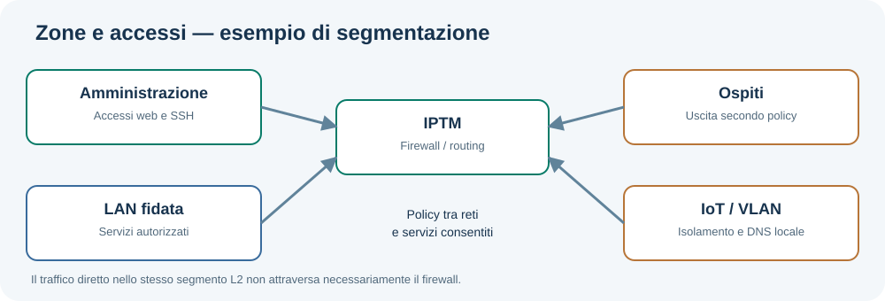
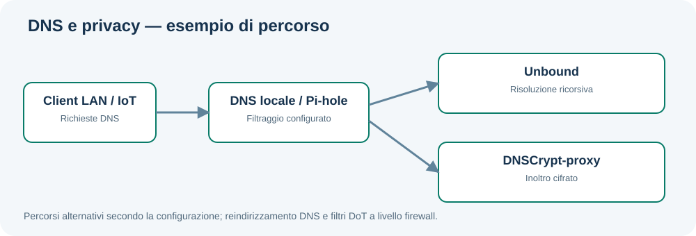
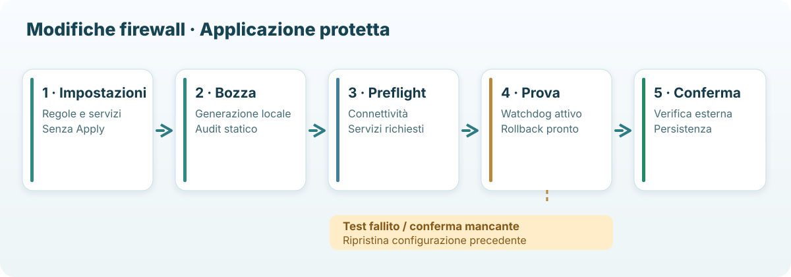

# IPTM — Firewall, rete e sicurezza per Linux

  

**IPTM (iptables-manager)** è una console web per amministrare un gateway Linux Debian/DietPi: firewall, routing, segmentazione della rete, DNS, qualità del traffico e sicurezza dei dispositivi. Riunisce configurazione, osservazione e manutenzione in una sola interfaccia, utilizzabile anche da browser su smartphone.

[Scarica l'ultima release](https://github.com/Graycius/IPTM/releases/latest) · [Pacchetto 6.0.8](release/IPTM_6.0.8_UPDATE.zip) · [Guida di installazione](installer/LEGGIMI_INSTALLAZIONE.md) · [Licenza](LICENSE)

*Illustrazione schematica della console, non una cattura di una rete reale.*

## A cosa serve

IPTM può essere utilizzato per gestire un firewall locale o un router Linux che instrada il traffico tra Internet, reti fidate, VLAN, dispositivi IoT e tunnel VPN. Le funzioni si adattano alla topologia rilevata e alla disponibilità dei componenti del sistema. Le impostazioni possono essere preparate in bozza e verificate prima di essere applicate.

*Esempio di topologia: i segmenti e i servizi effettivi dipendono dall'installazione.*

## Indice

- [Panoramica e monitoraggio](#panoramica-e-monitoraggio)
- [Connessione e rete](#connessione-e-rete)
- [Rete locale e dispositivi](#rete-locale-e-dispositivi)
- [DNS e privacy](#dns-e-privacy)
- [Protezione e firewall](#protezione-e-firewall)
- [Sistema e strumenti](#sistema-e-strumenti)
- [Esempi operativi](#esempi-operativi)
- [Installazione e aggiornamento](#installazione-e-aggiornamento)
- [Requisiti e limiti](#requisiti-e-limiti)

## Panoramica e monitoraggio

| Pagina | Utilizzo |
| --- | --- |
| **Stato generale** | Quadro sintetico della configurazione, stato del firewall, interfacce, indicatori di protezione, servizi rilevati e collegamenti alle operazioni principali. |
| **Mappa della rete** | Esplora nodi e collegamenti, seleziona dispositivi, consulta indirizzi, zone e avvisi di incoerenza. |
| **Statistiche** | Consulta contatori di pacchetti e byte delle regole, blocchi e andamento del traffico disponibile. |
| **Connessioni** | Esamina connessioni attive, indirizzi, porte, protocolli e stato quando rilevabili. |
| **Monitoraggio** | Verifica attività, eventi e indicatori operativi della rete. |

Il menu raggruppa le operazioni per area; la ricerca laterale permette di trovare una funzione anche attraverso sinonimi. L'accesso amministrativo permette le modifiche; la modalità di sola lettura consente di consultare le informazioni disponibili.

## Connessione e rete

### Interfacce, VLAN e DHCP

- **Schede e collegamenti:** identifica schede, indirizzi IPv4, profili NetworkManager, stato, MTU e metrica.
- **Bond e porte:** consulta aggregazioni e prepara profili per le porte disponibili. Le operazioni che possono interrompere il collegamento richiedono il percorso di attivazione indicato dalla pagina.
- **VLAN:** prepara segmenti separati su una scheda parent e associa ID VLAN, subnet e indirizzo del gateway; la rete fisica deve supportare la configurazione.
- **DHCP:** gestisce le informazioni del server Pi-hole e prepara un servizio DHCP dedicato a una seconda rete. Le prenotazioni statiche associano MAC, IP e hostname; il controllo rileva conflitti e sovrapposizioni.
- **NetworkManager:** editor delle proprietà di un profilo, clonazione e prova con checkpoint temporaneo quando supportato. Le attivazioni che richiedono la console locale sono indicate esplicitamente.

### WAN, LAN e NAT

| Opzione | Funzione |
| --- | --- |
| Interfaccia WAN | Identifica il collegamento verso modem o Internet. |
| Interfaccia LAN / associazione subnet-ingresso | Collega reti locali e VLAN alle interfacce da cui devono arrivare i pacchetti. |
| WAN e LAN sulla stessa interfaccia | Supporta topologie a singola scheda o bond, nelle quali la distinzione dipende dalle subnet configurate. |
| Reti LAN | Definisce le reti IPv4 locali, in notazione CIDR. |
| NAT / masquerade | Permette alle subnet configurate di utilizzare l'indirizzo di uscita della WAN. |
| Interfacce di uscita NAT | Limita l'applicazione del masquerade alle uscite specificate. |
| Clamp MSS | Adatta la dimensione TCP al percorso, utile ad esempio con PPPoE e VPN. |
| IP forwarding | Consente al kernel Linux di instradare pacchetti fra interfacce. |
| Forza DNS locale / IP DNS | Reindirizza le richieste DNS TCP/UDP 53 delle LAN configurate al resolver scelto. |
| Blocca DNS-over-TLS | Filtra la porta 853 secondo la policy; non equivale a bloccare tutto il DNS-over-HTTPS. |

**Routing e servizi** raccoglie le funzioni di rete del gateway. **Porte inoltrate** permette di preparare regole NAT per pubblicare un servizio interno attraverso una porta esterna, definendo destinazione e protocollo. L'inoltro deve essere accompagnato da una policy di accesso coerente.

### VPN e IPv6

**VPN e tunnel** mostra i tunnel rilevati e le impostazioni WireGuard. Le autorizzazioni per le reti dei peer, l'accesso alle LAN, il forwarding e il NAT vanno configurati in base al ruolo del tunnel. Consentire la navigazione via VPN non implica consentire l'accesso a ogni servizio locale.

**IPv6** permette di gestire il ruleset IPv6 e le relative protezioni. **Conversione IPv6** prepara una proposta partendo da regole IPv4 e da una mappatura delle reti; NAT IPv4, ICMPv4 e moduli incompatibili non vengono convertiti automaticamente. La proposta deve essere verificata separatamente.

### Qualità del traffico — SQM / CAKE

SQM riduce l'accumulo di pacchetti nelle code del collegamento (bufferbloat) mediante il controllo della banda e la gestione delle code.

| Opzione | Funzione |
| --- | --- |
| WAN e velocità download/upload | Selezionano l'interfaccia da controllare e i limiti di shaping. |
| Calibrazione manuale | Misura la capacità del collegamento; lo shaping CAKE viene temporaneamente sospeso quando la procedura lo consente e poi ripristinato. |
| Controllo orario | Osserva la qualità del collegamento; non va confuso con uno speedtest continuo. |
| Regolatore RTT adattivo | Usa misure di latenza per il controllo adattivo opzionale. |
| Diffserv | Seleziona la modalità best effort, diffserv3, diffserv4 o diffserv8 per la gestione delle classi. |
| NAT, Wash DSCP, ACK filter | Opzioni CAKE per riconoscimento dei flussi dietro NAT, trattamento delle marcature DSCP e filtraggio degli ACK. |
| Priorità applicative | Regole DSCP IPv4 per protocollo, porta, classe, rete opzionale e direzione (upload/download). |
| Proprietà qdisc | Mostra la disciplina di coda attiva e le condizioni per IFB e shaping bidirezionale. |

Il riconoscimento Layer 7 consulta i protocolli applicativi osservati nei log Suricata EVE; l'analisi dei processi usa i socket locali Linux. Queste due viste sono diagnostiche, non classificatori DPI inline dei client LAN. La disponibilità di CAKE/IFB e della classificazione in download dipende dal kernel e dalla topologia.

**Prestazioni firewall** consente di analizzare l'overhead delle regole e gli indicatori disponibili senza modificare automaticamente le policy.

## Rete locale e dispositivi

| Pagina | Utilizzo |
| --- | --- |
| **Dispositivi** | Inventario dei dispositivi riconosciuti, associazione delle identità e accesso alle relative impostazioni. |
| **Zone e isolamento** | Definisce separazioni tra reti e dispositivi, regole IoT e accessi fra zone. |
| **Permessi di accesso** | Configura le autorizzazioni tra dispositivi, reti e servizi disponibili. |
| **Attività dispositivi** | Visualizza i flussi osservati dal router; non rappresenta necessariamente tutti i byte o le richieste DNS del dispositivo. |
| **Servizi e porte** | Consulta servizi e porte e gestisce le opzioni di accesso disponibili. |

**Zone e isolamento** offre modalità di protezione basate su MAC per traffico instradato e modalità VLAN per segmenti distinti. Per una rete IoT instradata sono disponibili la scelta dell'interfaccia, della subnet, del DNS locale, del comportamento IPv6 (blocco del forwarding o routing con isolamento), dei resolver noti da bloccare, del filtro QUIC e di un profilo di uscita restrittivo HTTP/HTTPS. Questi filtri possono interferire con alcune applicazioni e non garantiscono di eliminare ogni tunnel su HTTPS. Due dispositivi nella stessa rete di livello 2 possono comunicare senza attraversare IPTM: per separarli occorre una configurazione coerente di switch o access point.

## DNS e privacy

### Resolver DNS e Pi-hole

- **Resolver DNS:** informazioni e impostazioni dei resolver locali e dei componenti rilevati.
- **Filtri Pi-hole:** gestione delle liste di blocco, autorizzazioni e importazioni supportate; richiede Pi-hole disponibile.
- **Salute Pi-hole:** verifica dello stato e della raggiungibilità locale, distinguendo i controlli sul router dalle prove da un client LAN.
- **Unbound:** profili bilanciato, restrittivo e compatibile; opzioni di minimizzazione QNAME, hardening DNSSEC, privacy dell'identità e riduzione dei log. Le modifiche gestite sono validate e accompagnate da backup.
- **Audit DNS:** controlli in sola lettura sui resolver e sulla configurazione di privacy.

### DNS, TLS e Anti-DPI

La procedura guidata permette di preparare una catena DNS con i componenti disponibili e controllare la configurazione prima dell'attivazione.

| Opzione | Funzione |
| --- | --- |
| DNSCrypt-proxy | Resolver cifrati, configurazione del primario/secondario, stamp DNS e bootstrap facoltativo. |
| Prova con rollback | Verifica di una configurazione DNSCrypt con possibilità di recupero. |
| TLS/SNI osservato | Diagnostica degli eventi TLS disponibili e, se configurato, osservazione mediante regole Suricata per domini selezionati. |
| Anti-DPI | Gestione dei componenti Zapret2 e Zapret classico quando rilevati, con configurazioni e controlli dedicati. |
| Protezione DNS LAN | Le regole di reindirizzamento DNS e di blocco DoT si configurano nella pagina WAN, LAN e NAT. |

Pi-hole, Unbound e DNSCrypt possono svolgere ruoli differenti (filtraggio, risoluzione ricorsiva o inoltro cifrato). La concatenazione dipende da porte e configurazione effettive: lo schema illustrativo non prescrive un percorso obbligatorio.

## Protezione e firewall

### Firewall: policy di sicurezza

Le opzioni della pagina Firewall sono organizzate in gruppi:

| Gruppo | Cosa permette di configurare |
| --- | --- |
| Protezione firewall | Policy di base, controllo dello stato delle connessioni (SPI), filtraggio di pacchetti anomali e anti-spoofing. |
| Perimetro WAN e rate limit | Filtri WAN, ping, multicast, IDENT e limiti per traffico o connessioni anomale. |
| LAN, segmentazione e dispositivi | Reti ospiti, isolamento delle subnet, politiche MAC e quarantena. |
| Controllo avanzato e ALG | Controlli aggiuntivi, limiti e helper NAT disponibili. |
| Accesso alla gestione web | Restrizione delle reti autorizzate a raggiungere la console. |
| ICMP, flood e servizi LAN | Gestione del traffico ICMP, protezioni contro flood e regole per i servizi locali. |
| Accesso servizi e anti brute-force | Impostazioni di accesso, SSH e protezioni dei tentativi ripetuti; opzioni di port knocking se configurate. |
| Chiusura e policy finale | Comportamento per traffico e porte non autorizzati. |
| Anti-lockout e hardening avanzato | Reti amministrative distinte, continuità dell'accesso e protezioni aggiuntive dell'host. |

La rete amministrativa deve essere identificabile e non coincidere automaticamente con tutte le reti di transito. In presenza di più LAN impostare esplicitamente le reti che devono amministrare il gateway.

### Editor e revisione delle regole

| Pagina | Funzione |
| --- | --- |
| **Regole firewall** | Consulta e filtra le regole per tabella e catena; gestisci l'ordine e le modifiche in bozza. |
| **Nuova regola** | Definisci protocollo, sorgente e destinazione, interfacce, porte, stato conntrack, target, posizione e commenti; supporta anche opzioni iptables avanzate. |
| **Procedura guidata** | Prepara regole mediante una sequenza guidata di parametri. |
| **Catene** | Gestisci catene e policy di default ACCEPT/DROP. |
| **Analizza rules.v4** | Analizza le regole persistenti e propone correzioni, ridondanze e incoerenze senza applicarle automaticamente. |
| **Editor regole** | Modifica il testo in formato iptables-restore nella bozza. |
| **Conversione manuale** | Strumenti di conversione delle regole e preparazione del formato utilizzabile dall'editor. |

INPUT regola i pacchetti destinati al gateway; FORWARD quelli che lo attraversano; OUTPUT il traffico originato dal gateway. L'ordine delle regole è fondamentale: una decisione definitiva precedente può rendere irraggiungibile quella successiva.

### Sicurezza integrata

| Componente / pagina | Funzioni disponibili |
| --- | --- |
| **CrowdSec** | Stato motore e bouncer, decisioni, alert, metriche, scenari, collezioni, feed, simulazione e integrazione firewall. L'effettivo blocco richiede un bouncer configurato e operativo. |
| **Suricata** | Stato del motore e consultazione delle rilevazioni; l'azione preventiva dipende dalla modalità e dal punto di aggancio effettivi. |
| **Liste e GeoIP** | Gestione di liste di indirizzi da filtrare e opzioni geografiche disponibili; verificare le fonti e l'aggiornamento dei dati. |
| **Hardening** | Verifica dei parametri sysctl di rete e configurazione controllata delle protezioni del kernel. |
| **Antivirus** | Verifica hash, URL e scansioni di file mediante servizi configurati; ClamAV locale e VirusTotal richiedono i rispettivi componenti/credenziali. Il caricamento di file verso servizi esterni può condividere il contenuto. |
| **Analisi HTTPS** | Integrazione con proxy esplicito mitmproxy/ClamAV per soli client e reti autorizzati; non intercetta automaticamente tutto il traffico. Richiede configurazione dedicata e fiducia del client nel certificato. |
| **Attacchi** | Aggrega pattern rilevati dai log, sorgenti sospette e porte colpite; può arricchire gli indicatori tramite fonti esterne opzionali. |

## Sistema e strumenti

### Applicazione sicura

La pagina **Applica configurazione** confronta bozza e regole persistenti, esegue controlli preliminari e consente l'applicazione con watchdog e rollback. Confermare il salvataggio definitivo soltanto dopo aver verificato che l'accesso amministrativo e la connettività necessaria siano disponibili. Le regole create dinamicamente da altri programmi possono richiedere il ripristino tramite i rispettivi servizi.

### Centro operativo e manutenzione

| Pagina | Funzione |
| --- | --- |
| Centro operativo | Stato dei processi e collegamenti ai controlli principali. |
| Diagnostica / Salute sistema | Errori, preflight, componenti, permessi, audit DietPi e strumenti di verifica disponibili (incluso Lynis se installato). |
| Log / Cronologia | Eventi firewall e operazioni registrate. |
| Controllo dopo apply | Verifiche successive all'applicazione. |
| Analisi pacchetti | Analisi del percorso previsto dai criteri delle regole; non sostituisce una cattura del traffico reale. |
| Impatto regole / Consigli | Confronto e indicazioni sulle configurazioni. |
| Servizi / Programmi | Stato e gestione dei componenti supportati. |
| Ricerca avanzata | Ricerca di regole e informazioni disponibili. |
| Configurazione iniziale / Piano di sicurezza | Preparazione di un profilo di base o di un piano di protezione, con verifica prima di applicarlo. |
| Importa regole | Importazione delle regole da elaborare e verificare. |
| Utenti | Gestione degli accessi alla console. |
| Nuove opzioni / Guida | Configurazione guidata delle funzioni disponibili e guida integrata. |

### Backup, aggiornamenti e pulizia

**Backup, importazione e ripristino** esporta le impostazioni IPTM e le bozze IPv4/IPv6; l'importazione prepara i dati in bozza. L'esportazione JSON v2 non comprende credenziali o chiavi e non sostituisce il backup dei servizi o del sistema operativo.

**Pulizia** configura la politica di conservazione dei backup e delle release, l'anteprima degli elementi eliminabili e la rotazione periodica. Configurazioni attive, recuperi in corso e backup protetti non sono candidati alla normale rotazione.

**Aggiornamenti** installa pacchetti Native Update compatibili, verificando versione, struttura e integrità. Supporta il caricamento ZIP e il download tramite URL, anche HTTP con SHA-256 esterno attendibile. La firma digitale è facoltativa; quando è presente e verificabile viene controllata. L'hash non autentica da solo l'autore del pacchetto.

## Esempi operativi

### 1. Separare una rete IoT

1. In **Interfacce, VLAN e DHCP**, individua la scheda e la VLAN, oppure prepara il segmento dedicato.
2. In **WAN, LAN e NAT**, associa la subnet all'interfaccia corretta.
3. In **Zone e isolamento**, definisci il DNS locale, la policy verso le reti fidate e il comportamento IPv6.
4. Controlla la bozza e applicala con rollback. Verifica navigazione, DNS e impossibilità di raggiungere le risorse locali non autorizzate da un dispositivo IoT reale.

### 2. Migliorare la latenza sotto carico

1. Apri **Qualità del traffico**, seleziona la WAN ed esegui la calibrazione a collegamento libero.
2. Imposta i limiti download/upload e un profilo CAKE compatibile.
3. Prepara eventuali priorità DSCP; verifica qdisc, IFB e condizioni di attivazione.
4. Misura latenza e throughput con traffico reale prima e dopo l'applicazione.

### 3. Consentire un servizio dalla VPN

1. Verifica tunnel e subnet peer in **VPN e tunnel**.
2. Identifica indirizzo e porta del servizio interno.
3. Prepara un permesso limitato a sorgente VPN, destinazione e servizio necessari.
4. Verifica il forwarding e il percorso di ritorno, quindi prova l'accesso senza aprire la gestione alle altre reti.

## Installazione e aggiornamento

IPTM richiede un gateway Linux Debian/DietPi con systemd, Python 3, PHP 8 o superiore, Bash, sudo e iptables, oltre a un server web già configurato per eseguire PHP. Il kernel e i pacchetti opzionali devono supportare le funzioni che si vogliono utilizzare.

- **Prima installazione:** consulta la [guida dell'installer](installer/LEGGIMI_INSTALLAZIONE.md). Utilizza un pacchetto di prima installazione compatibile; un Native Update non è un installer completo.
- **Installazione esistente:** dalla pagina **Sistema e strumenti → Aggiornamenti**, carica il pacchetto Native Update dell'[ultima release](https://github.com/Graycius/IPTM/releases/latest). In alternativa usa l'URL del pacchetto e, per HTTP, lo SHA-256 ottenuto da una fonte attendibile indipendente.
- **Accesso:** apri `http://IP_DEL_SERVER/iptables-manager.php` sulla porta del server PHP configurato. Mantieni la console accessibile soltanto da reti amministrative fidate; HTTP non cifra le credenziali.

Prima di modificare una configurazione di rete conserva un backup e un percorso di recupero locale.

## Requisiti e limiti

IPTM utilizza PHP per la console, JavaScript per l'interfaccia e componenti Python/Bash con helper privilegiato per interagire con Linux. Le integrazioni (NetworkManager, Pi-hole, Unbound, DNSCrypt, WireGuard, CrowdSec, Suricata e altre) dipendono dall'installazione e dalla configurazione reali. La gestione IPv4 e IPv6 non è integralmente equivalente; le policy IPv6 richiedono verifica dedicata. Il firewall controlla il traffico che lo attraversa, non quello scambiato direttamente fra client sullo stesso segmento L2. I controlli offline del codice non sostituiscono il collaudo sul gateway.

## Licenza e risorse

- [Licenza GNU GPL](LICENSE)
- [Release e pacchetti](https://github.com/Graycius/IPTM/releases)
- [Segnalazioni e problemi](https://github.com/Graycius/IPTM/issues)
- [Politica di sicurezza](SECURITY.md)
